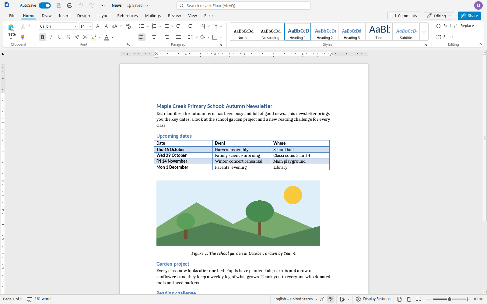
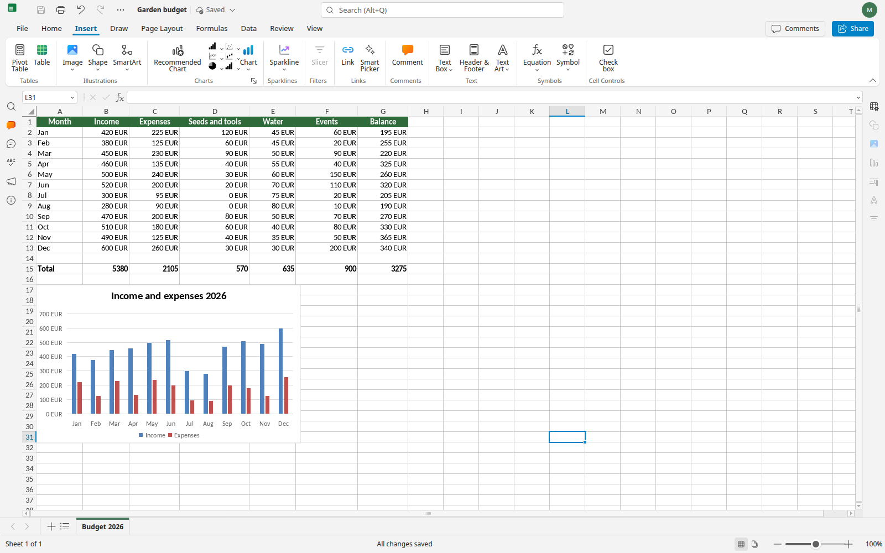
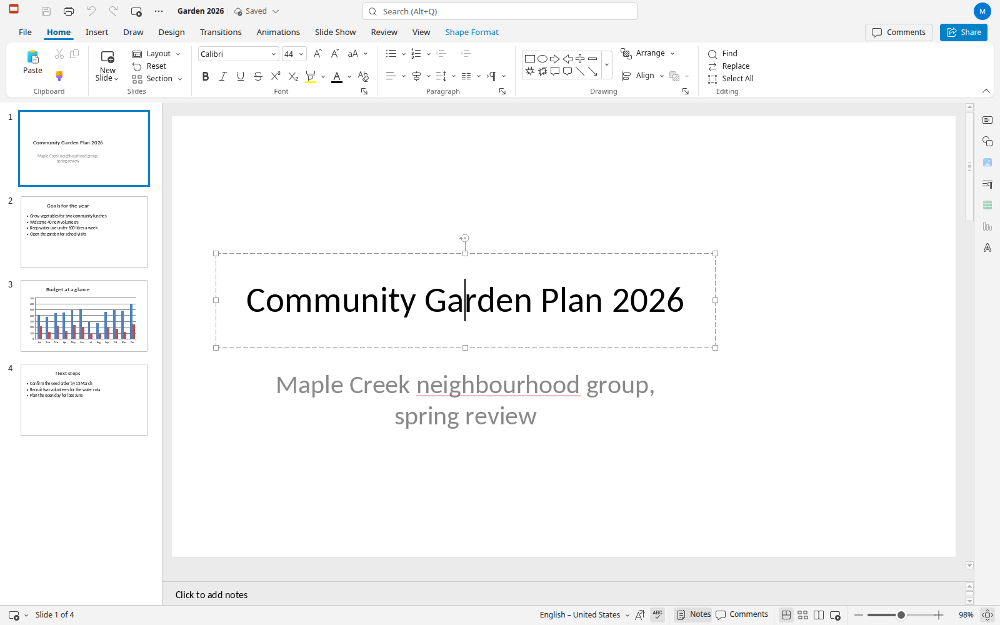
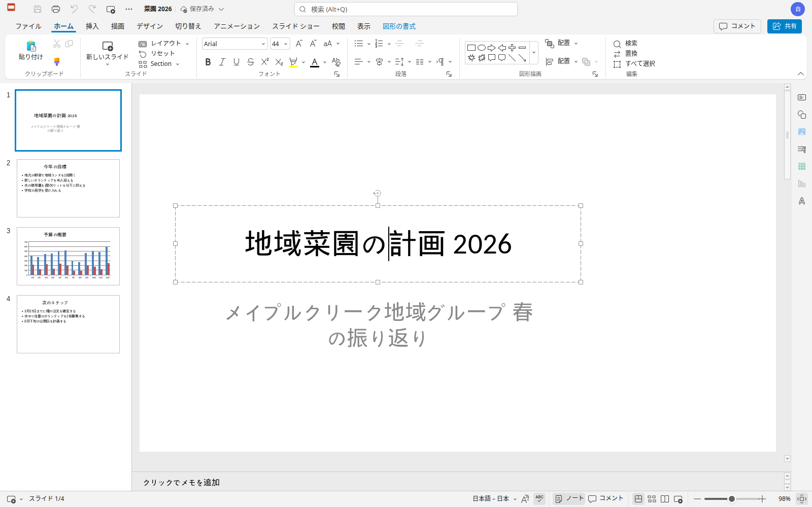

# ElixirOffice

**An open source office suite for people used to Microsoft Office.**

ElixirOffice edits Word, Excel and PowerPoint documents (and their OpenDocument equivalents) with the ribbon, menus, dialogs and keyboard shortcuts of Microsoft Office. It runs in the browser on your own server, or as a desktop app that works entirely offline. It is free software (AGPLv3), private by design, and fast.

> Status: **beta**. This first public version is a beta: the server version and the Linux and Windows desktop apps are ready to try, the macOS app is coming. Expect rough edges, and please report them. Desktop builds are not signed yet. Known limitations are listed in the release notes.

## Why this project

My partner is a teacher. Like many of her colleagues, she has been offered the open source office suites at school again and again, and every time she went back to Microsoft Office. Not out of brand loyalty: the alternatives felt unfamiliar, documents from colleagues did not look right, and the habits of years (the ribbon, the shortcuts, where things are) did not work anymore.

They would love an office suite that is open source **and** easy to use. ElixirOffice is an attempt at exactly that: keep the strong, mature engine of an existing open source suite, and rebuild everything people touch so that a Word, Excel or PowerPoint user feels at home on the first day, with documents that look the same as in Microsoft Office.

## What makes it different

- **It behaves like Microsoft Office.** The same ribbon tabs and groups, KeyTips (Alt), mini toolbar, quick access toolbar, contextual tabs, and the same keyboard shortcuts: 228 Word shortcuts work on Windows and 171 on macOS, including Repeat (F4 / Ctrl+Y), Outline, Read and Draft views, fields, block selection, mail merge, Flash Fill, Quick Analysis, sections and the Slide Sorter. Muscle memory keeps working.
- **Your documents look right.** Layout fidelity to Word is measured on a document corpus, release after release. Free metric-compatible fonts keep line and page breaks without Microsoft fonts, and in Chrome or Edge one click lets the editor use the fonts installed on your computer. School fonts (Marelle and Seyes-ruled cursive substitutes) are included.
- **Private by design.** No telemetry, nothing sent to the publisher. In local mode and in the desktop app, documents never leave your computer: they are converted, edited and exported to PDF entirely on your machine.
- **AI only if you want it.** The suite is complete without AI. If you configure a model (any OpenAI-compatible service, including Ollama on your own computer), it can work on the structure of your document (styles, lists, tables, table of contents, page setup), with every change shown as a tracked change and undone in one step.
- **Your own cloud: Murena Workspace and Nextcloud.** Connect your Murena Workspace or Nextcloud from the start page (secure Login Flow, revocable app password, nothing stored in the browser): browse, open, save back with conflict protection, recent files, new documents and uploads; or edit directly from Nextcloud Files with the bundled Nextcloud app. Your real name appears on comments, tracked changes and co-editing. Coming to the desktop app after the first release.
- **International.** Every feature works in many languages: 45 interface languages, spelling in 49 languages, a thesaurus in 17.

### More things you will like

- **PDF made on your computer**: Download as PDF and Print create the PDF locally, with the fonts you see on screen.
- **Your computer's fonts**: in Chrome or Edge, one click and the editor uses the fonts installed on your computer, nothing uploaded.
- **Comments in the margin**, like Word: balloons next to the text, reply and resolve in place.
- **Mail merge** from a CSV or Excel file to one document, one PDF or one PDF per recipient.
- **Outline, Read Mode, Draft view, split window, block selection, fields** and the Selection and Reveal Formatting panes.
- **AutoCorrect while typing** and **spelling suggestions on right-click**, in many languages; an offline **thesaurus** (Shift+F7).
- **Pictures that stay where you put them**, and tables that behave (grouped shapes stay in their cell, copied cells keep rotated text and colours).
- **Excel and PowerPoint habits**: Flash Fill (Ctrl+E), Quick Analysis (Ctrl+Q), Auto Fill Options, chart galleries by type, F4 for Repeat and absolute references; Slide Sorter, sections, Selection pane and Presenter View with the next slide.
- **Office keys the browser normally keeps** (Ctrl+W, Ctrl+N, Ctrl+Tab...): install ElixirOffice as an app or use full screen, or use the documented alternatives.
- **AI with your own model**: ask from the search box, a right-click or "/" in the text; any OpenAI-compatible service, including a model running on your own computer.

The complete list: [docs/features.md](docs/features.md).

## Fast, thanks to an optimised WebAssembly converter

The document converter (the C++ engine that reads and writes .docx, .xlsx, .pptx, .odt, .ods and .odp) is compiled to **WebAssembly** and runs inside the browser or the desktop app:

- built with native WebAssembly exceptions and a reworked static initialisation, which cut the module from 106 MB to 53 MB and made large documents open about ten times faster than a plain build;
- a 97-page Word document is converted in about **0.4 s**; saving it takes **0.08 s**;
- the module downloads once, **3.1 MB compressed** (Brotli), then stays in the browser cache;
- PDF export uses the same native PDF writer as the server, in the browser: same quality and same file size as a server-made PDF, with no upload;
- only the fonts a document uses are loaded.

On a modest laptop (Intel i5-8265U), a 97-page document becomes editable in about 3.5 s, layout continues in the background, and typing latency stays around 30 ms. Measurements and methods: [docs/wasm.md](docs/wasm.md), [docs/perf.md](docs/perf.md), [docs/desktop-options.md](docs/desktop-options.md).

## Screenshots

| Word | Excel | PowerPoint |
|---|---|---|
|  |  |  |

In your language (here French, German and Japanese):

| Français | Deutsch | 日本語 |
|---|---|---|
|  |  |  |

## Two ways to use it

| | Server version | Desktop app |
|---|---|---|
| For | organisations, Murena Workspace / Nextcloud, shared documents | individuals, offline use |
| How | your own server (Docker), in the browser | Linux (AppImage, .deb), Windows (installer), macOS (coming) |
| Documents | real-time co-editing, cloud storage; optional "convert locally" mode | 100 % local, no document server |
| Install | [docs/install-server.md](docs/install-server.md) | [docs/desktop.md](docs/desktop.md) |

## Try it

All downloads are on the **[Releases](../../releases)** page (the first beta packages are being published there shortly after the source code).

**Desktop app (offline, nothing to install on a server)**

- **Linux**: download the `.AppImage`, make it executable (`chmod +x ElixirOffice-*.AppImage`) and run it; or install the `.deb` with `sudo apt install ./elixiroffice_*.deb`.
- **Windows**: download and run the installer. The preview is not signed yet, so Windows SmartScreen shows a warning: click **More info**, then **Run anyway**.
- **macOS**: coming soon.

Then open a .docx, .xlsx, .pptx, .odt, .ods or .odp file (double-click, drag and drop, or File > Open), edit it and save: the file stays on your computer.

**Server version (in the browser, for a team or an organisation)**

On a Linux host with Docker, download the server bundle from the Releases page and follow [docs/install-server.md](docs/install-server.md): an init script generates the secrets, `docker compose up -d` starts the suite behind HTTPS, and you open it in your browser. AI is off unless you configure it; connecting Murena Workspace or Nextcloud is described in the guide.

## Features

The detailed, benefit-oriented list of what has been built (Word, Excel and PowerPoint parity, fidelity, privacy, AI) is kept up to date in [docs/features.md](docs/features.md). A comparison with LibreOffice and ONLYOFFICE is in [docs/differences.md](docs/differences.md).

## Building from source

- Server image and development environment: [docs/dev.md](docs/dev.md), [docs/images.md](docs/images.md)
- WebAssembly converter: [docs/wasm.md](docs/wasm.md) (`tools/wasm/build.sh`)
- Desktop app: [docs/desktop.md](docs/desktop.md)

## Licence and attribution

ElixirOffice is free software, released under the **GNU Affero General Public License v3.0** ([LICENSE](LICENSE)), the same licence as the projects it derives from.

It is built on **[Euro-Office](https://github.com/Euro-Office)**, itself derived from **[ONLYOFFICE](https://www.onlyoffice.com/)** Docs by Ascensio System SIA. Their copyright notices, licence files and attributions are kept in the source code; see [NOTICE](NOTICE). Bundled fonts, dictionaries, thesauri and icons (Microsoft Fluent UI System Icons, MIT) keep their own free licences: [branding/fonts/LICENSES.md](branding/fonts/LICENSES.md), the dictionaries and thesaurus licence files, and [NOTICE](NOTICE).

ElixirOffice is not affiliated with or endorsed by Microsoft, Ascensio System SIA or the Euro-Office project. Microsoft, Word, Excel and PowerPoint are trademarks of Microsoft Corporation.

## Contributing, bug reports and feedback

Feedback from real users, especially anyone who switched from Microsoft Office, is the most valuable contribution.

- **Report a bug**: open an [issue](../../issues) with the version (Help > About, or the release name), your system and browser, what you did, what you expected and what happened. A screenshot helps. If a document triggers the problem, attach a small example **only if it contains nothing private**; otherwise describe it, or recreate the problem in a new document.
- **"It does not work like in Word / Excel / PowerPoint"**: these reports are welcome as issues too. Tell us what Microsoft Office does (the menu, the shortcut, the result) and what ElixirOffice does instead.
- **Ideas and questions**: use [Discussions](../../discussions).
- **Code**: pull requests are welcome; read [CONTRIBUTING.md](CONTRIBUTING.md) first (how to build, run the tests, commit conventions). Changes to the editor engine and interface live in the forked component repositories listed there.

## How it was made

ElixirOffice was initiated and supervised by **Gaël Duval**, and developed with various large language models working as coding agents under his direction. Every change goes through automated test suites, reviews and measurements before it is integrated.
