<!-- SPDX-License-Identifier: AGPL-3.0-only -->
# AI-assisted features

**0.4 preview documentation: these features are held for review.** Screenshots
below show the real Linux desktop interface, neutral English documents and
deterministic demonstration replies. They show actual editor operations, not
examples of a particular model's quality. No provider was contacted and no API
key was used.

## Optional, with a destination you choose

AI is **optional and off by default**. Ask Elixir remains visible; before setup,
it opens the setup assistant. Nothing is sent to an inference service until you
configure one and consent. Connection checks and requests require your action.

You choose where document context goes: any compatible inference service
provider, or your own locally hosted inference. The service must support the
OpenAI-compatible tool-calling features required by the action; compatibility
and results vary. There is no automatically selected or endorsed provider.
Remote services use HTTPS; supported explicit loopback addresses can connect
to locally hosted inference.

**Note on EU-based services:** some may still be subject to the US CLOUD Act,
for example through a US parent company or US operations. Check carefully where
you send your context data, including the contracting entity and current terms.

### EU-based services that state they are not subject to the US CLOUD Act

The following are published provider statements about the named EU offers,
not a legal determination or an ElixirOffice integration certification:

- **Scaleway Generative APIs (France):** its [service privacy policy](https://www.scaleway.com/en/docs/generative-apis/reference-content/data-privacy/) describes European inference/Paris storage and protection from the CLOUD Act; its [public API](https://www.scaleway.com/en/developers/api/generative-apis) is OpenAI-compatible. Accessed 27 October 2026.
- **OVHcloud AI Endpoints (EU offer, France):** the [service description](https://www.ovhcloud.com/en/public-cloud/ai-endpoints/) specifies OpenAI compatibility and EU execution; its [legal protection statement](https://www.ovhcloud.com/en/personal-data-protection/legal-privacy-security/) and [AI sovereignty statement](https://www.ovhcloud.com/en/solutions/uc-artificial-intelligence/) cover extraterritorial-law protection, including the CLOUD Act. Accessed 27 October 2026.

Headquarters, ownership, service scope and excluded candidates
are documented separately. Mistral La Plateforme, Nebius AI Studio/Token Factory,
Aleph Alpha and IONOS AI Model Hub were checked but excluded because the complete
service-specific evidence required for this list could not be verified.

If you know other responsible inference providers, EU-based or not, [suggest them in an issue](https://github.com/leag1234/ElixirOffice/issues); we will review primary sources against the applicable criteria before deciding whether and where to list them.

This is not legal advice; providers' status and terms can change.

The ElixirOffice publisher receives no document data from these AI features.
Requests go to your chosen service, directly or through your organization's
configured proxy. Check that service's retention and access policies.

**Desktop API keys are encrypted by the operating system.** They are not written
as plain text to desktop settings; storage is refused if secure encryption is
unavailable. A server-managed key stays on that server. Browser-direct settings
have a different storage policy; see [connection and privacy details](ai.md).

| Start with empty settings | Review the real desktop consent dialog |
|---|---|
| 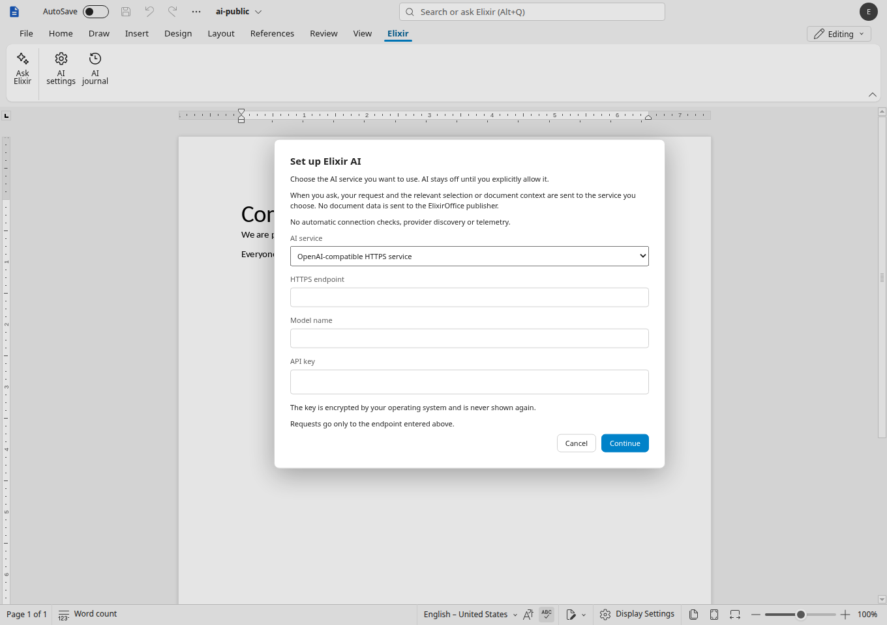 | 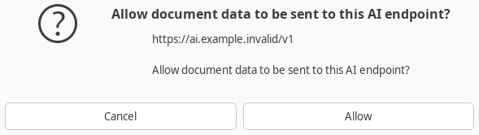 |

The example address is deliberately nonfunctional. No request is automatically
replayed after consent.

## Word: ask where you work

Select text and use the sparkle or right-click menu. Title search offers
**Ask Elixir** alongside ordinary commands; type **/** in an empty paragraph for
the quick menu. Describe the change, inspect the result, then accept or undo it.

| Selection sparkle | Right-click menu | Title search |
|---|---|---|
| 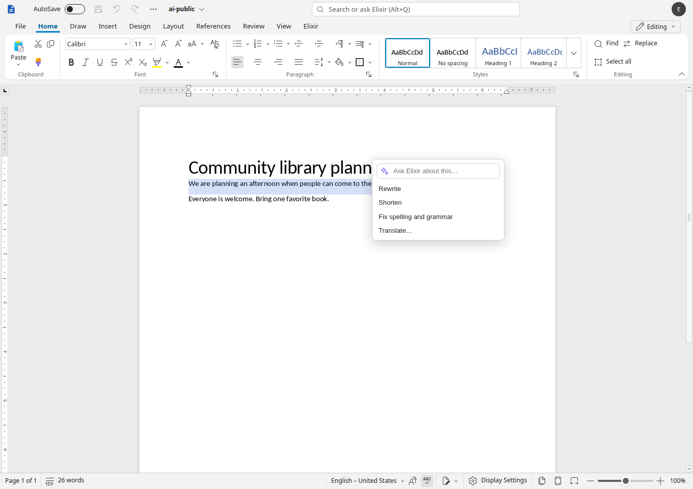 | 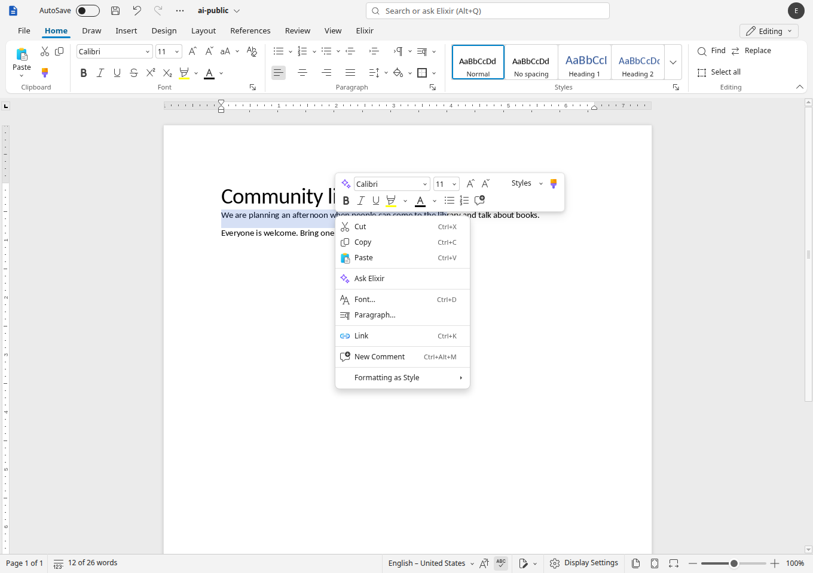 | 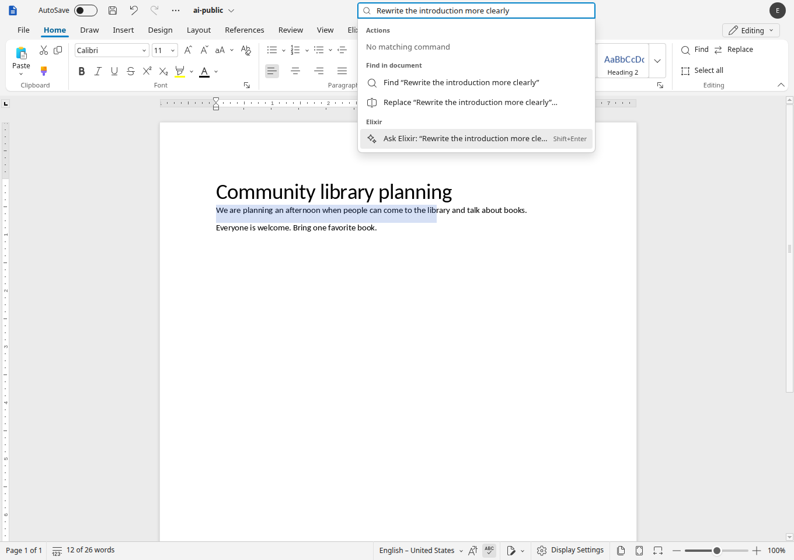 |

| Slash menu in an empty paragraph | A rewritten introduction ready for review |
|---|---|
| 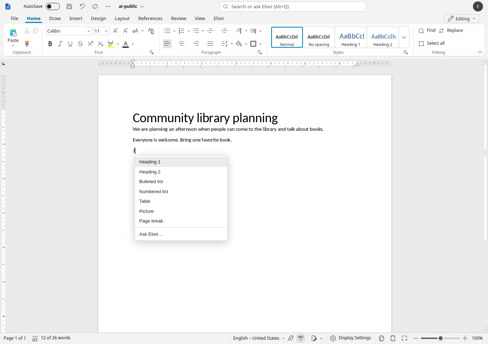 | 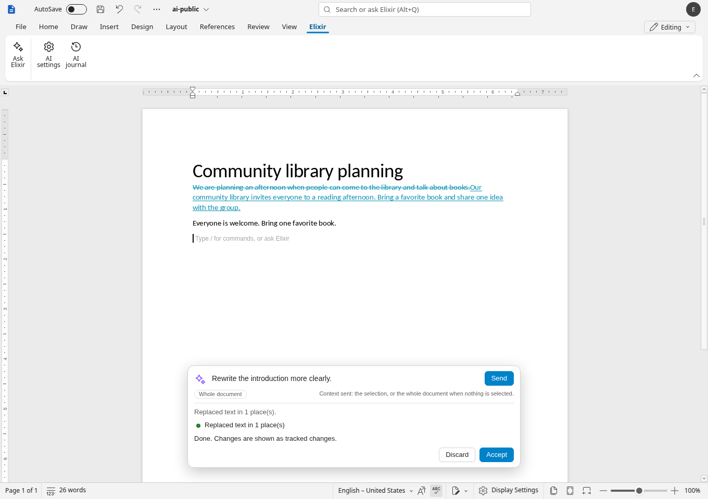 |

## Spreadsheet: act on a bounded table

Ask for formulas, literal-text cleaning, charts or a new pivot table. Select the
source table and specify headers, output ranges and ambiguous number/date
formats. Review the actual values and formulas; an editing action has one Undo.

| Calculate line totals | Trim extra spaces |
|---|---|
| 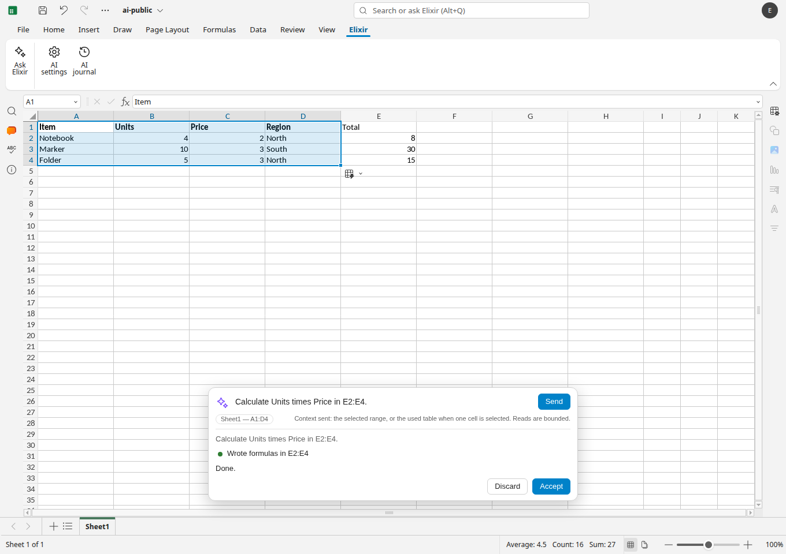 | 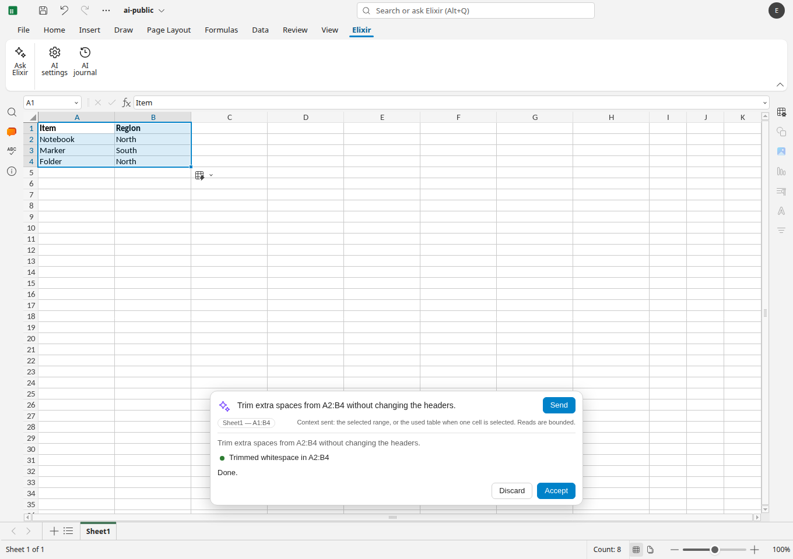 |

| Chart the source data | Summarize units by region on a new sheet |
|---|---|
| 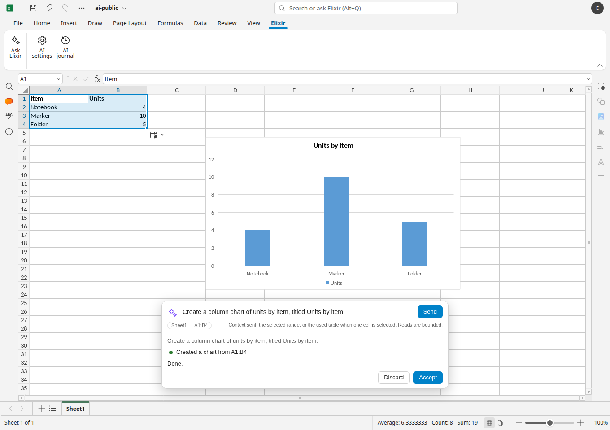 | 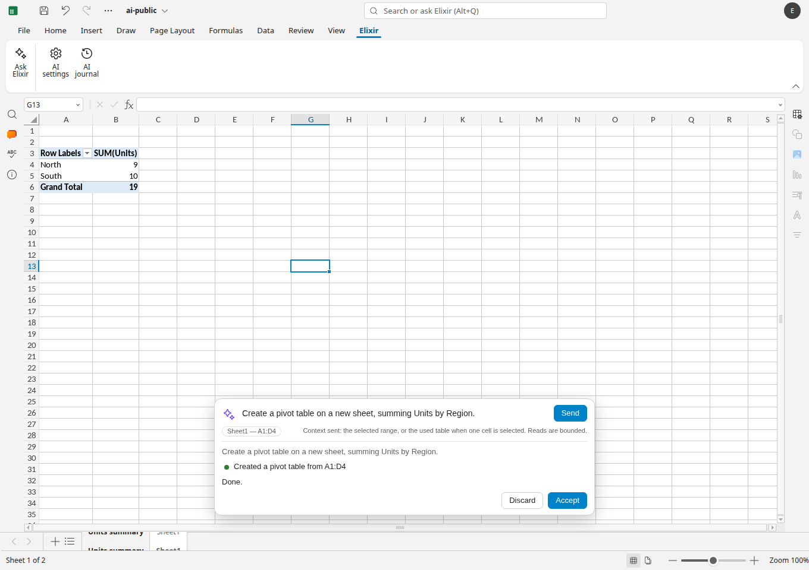 |

## Presentation: turn an outline into slides

Supply a topic, selected text or an outline. The assistant can append slides,
rewrite supported text, use embedded layouts/themes, align drawings, edit speaker
notes and summarize captured deck text. It does not interpret image content or
arbitrary embedded objects. Unsupported rich text is refused rather than flattened.

| Two slides from a supplied outline | Accepted speaker notes in the expanded pane |
|---|---|
| 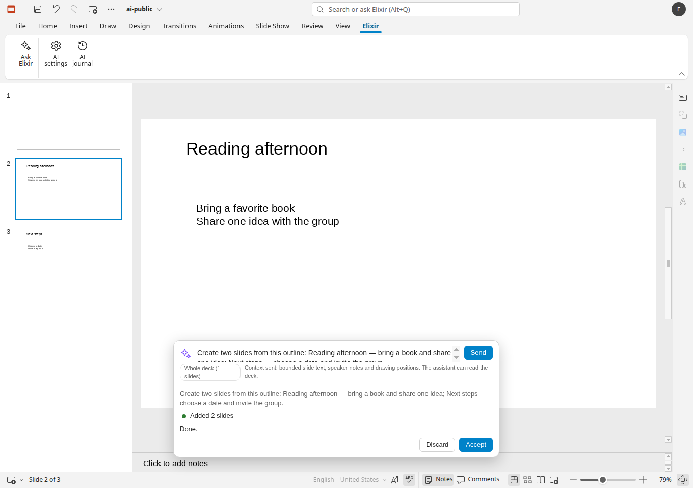 | 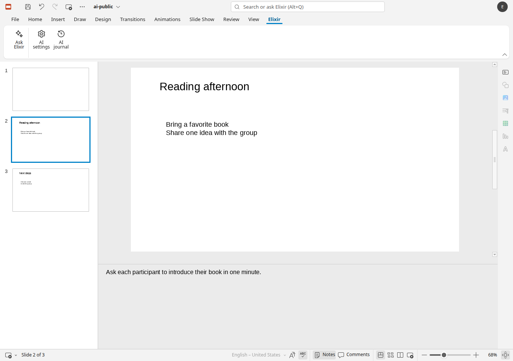 |

Check output before relying on it. Unsupported requests and safe refusals are
reported; an AI action is not a guarantee of correctness. [Word architecture and
measurements](ai.md), [spreadsheet limits](ai-cell-tools.md) and
[presentation limits](ai-slide-tools.md) distinguish deterministic interface
checks from real-model evaluation and unverified platforms.
